# 📡 System Telemetrii i Monitoringu Gleby: LoRa Point-to-Point / Mesh

Kompletny, energooszczędny system telemetryczny do bezprzewodowego monitorowania wilgotności gleby i stanu zasilania węzłów polowych. Projekt realizuje dwukierunkową transmisję radiową dalekiego zasięgu (LoRa 868 MHz) z potwierdzeniem odbioru (Stop-and-Wait ARQ / ACK), buforowanie w bazie SQLite oraz wizualizację na żywo przez interfejs WWW serwowany z komputera pokładowego Raspberry Pi.

---

## 🏗️ Architektura Systemu

```mermaid
flowchart LR
    subgraph S["🌱 Węzeł Pomiarowy (Sensor Node)"]
        direction TB
        E5["Seeed LoRa-E5 mini<br/>(STM32WLE5JC Cortex-M4 @ 48 MHz)"]
        SOIL["Pojemnościowy Czujnik Gleby<br/>(Capacitive Soil Moisture v1.2)"]
        SOIL -- "AOUT (PB3 / ADC_IN2)" --> E5
    end

    subgraph B["📻 Brama / Mostek (LoRa Bridge)"]
        direction TB
        XIAO["Seeed XIAO nRF52840<br/>(Nordic Cortex-M4F @ 64 MHz)"]
        WIO["Seeed Wio-SX1262<br/>(Semtech SX1262 LoRa Modul)"]
        WIO -- "SPI + IRQ" --> XIAO
    end

    subgraph RPI["🖥️ Stacja Bazowa / Serwer (Raspberry Pi)"]
        direction TB
        BRIDGE["Mostek szeregowy (serial_bridge.py)"]
        DB[(Baza SQLite: sensors.db<br/>Tryb WAL + Composite Index)]
        API["Serwer FastAPI (app.py)"]
        UI["Panel WWW (index.html / Chart.js)"]

        BRIDGE -- "INSERT" --> DB
        DB -- "SELECT" --> API
        API -- "HTTP JSON / REST" --> UI
    end

    subgraph CLIENT["📱 Użytkownik"]
        BROWSER["Przeglądarka WWW / Smartfon<br/>(http://&lt;IP_RPi&gt;:8000)"]
    end

    E5 -- "LoRa 868 MHz (Ramka JSON)" --> WIO
    WIO -- "LoRa 868 MHz (Potwierdzenie ACK)" --> E5
    XIAO -- "Hardware UART (D6 TX, D7 RX) /dev/serial0" --> BRIDGE
    UI --> BROWSER
```



---

## 🔌 Używany Sprzęt i Podłączenie (Hardware & Pinout)

System wykorzystuje trzy wyspecjalizowane urządzenia sprzętowe:

### 1. Węzeł Pomiarowy (Czujnik Gleby) – `sensor/`
* **Płytka główna:** [Seeed Studio LoRa-E5 mini](https://wiki.seeedstudio.com/LoRa_E5_mini/) z jednoukładowym SoC **STM32WLE5JC** (ARM Cortex-M4 @ 48 MHz, 256 KB Flash, 64 KB RAM, zintegrowany modem radiowy Semtech SX126X).
* **Czujnik:** Analogowy pojemnościowy czujnik wilgotności gleby (*Capacitive Soil Moisture Sensor v1.2 / v2.0* odporny na korozję elektrolityczną).
* **Programator:** ST-Link v2 (interfejs SWD).

#### Tabela połączeń wyprowadzeń STM32WLE5JC (LoRa-E5 mini):
| Pin LoRa-E5 | Funkcja mikrokontrolera | Podłączone urządzenie | Opis techniczny |
| :--- | :--- | :--- | :--- |
| **`PB3`** | `ADC_IN2` | **Czujnik gleby (AOUT)** | Wejście analogowe przetwornika ADC z 16-krotnym oversamplingiem sprzętowym |
| **`3V3`** | Zasilanie 3.3V | **Czujnik gleby (VCC)** | Zasilanie czujnika pojemnościowego |
| **`GND`** | Masa układu | **Czujnik gleby (GND)** | Wspólna masa analogowa i cyfrowa |
| **`PA4`** | GPIO Output | **RF Switch CTRL1** | Sterowanie torem odbiorczym przełącznika antenowego (RX: PA4=1, PA5=0) |
| **`PA5`** | GPIO Output | **RF Switch CTRL2** | Sterowanie torem nadawczym przełącznika antenowego (TX HP: PA4=0, PA5=1) |
| **`PB0`** | `PWR_VDDTCXO` | **Oscylator TCXO 32 MHz** | Automatyczne zasilanie stabilizowanego oscylatora TCXO z wewnętrznego LDO |
| **`PB5`** | GPIO Output | **Dioda LED (User)** | Dioda sygnalizacyjna na płytce (załączana podczas aktywnego pomiaru i transmisji) |
| **`PB6`** | `USART1_TX` | Debug UART / USB-C | Konsola diagnostyczna 115200 baud |
| **`PB7`** | `USART1_RX` | Debug UART / USB-C | Odbiór komend serwisowych |
| **`PA13`** | `SWDIO` | ST-Link Pin SWDIO | Programowanie i debugowanie SWD |
| **`PA14`** | `SWCLK` | ST-Link Pin SWCLK | Zegar magistrali programowania SWD |

---

### 2. Mostek Radiowy (Brama LoRa) – `lora_bridge/`
* **Mikrokontroler:** [Seeed Studio XIAO BLE nRF52840 Sense](https://wiki.seeedstudio.com/XIAO_BLE/) (Nordic nRF52840, ARM Cortex-M4F @ 64 MHz, Bluetooth 5.0, 1 MB Flash, 256 KB RAM).
* **Moduł radiowy:** [Seeed Studio Wio-SX1262 for XIAO](https://wiki.seeedstudio.com/wio_sx1262_for_xiao/) (Semtech SX1262 LoRa, wbudowany TCXO 32 MHz i przełącznik RF).

#### Tabela połączeń wyprowadzeń (XIAO nRF52840 $\leftrightarrow$ Wio-SX1262 oraz Raspberry Pi):
| Pin XIAO | Połączenie moduł Wio-SX1262 | Połączenie Raspberry Pi | Opis funkcjonalny |
| :--- | :--- | :--- | :--- |
| **`D1` (P0.03)** | `DIO1` | - | Przerwanie odbioru/nadania ramki (*RxDone* / *TxDone*) |
| **`D2` (P0.28)** | `RESET` | - | Sprzętowy reset modemu radiowego (aktywny stanem LOW) |
| **`D3` (P0.29)** | `BUSY` | - | Linia zajętości układu radiowego SX1262 |
| **`D4` (P0.04)** | `NSS` (CS) | - | Sprzętowy wybór układu SPI (Chip Select) |
| **`D5` (P0.05)** | `RXEN` | - | Sterowanie torem odbiorczym zewnętrznego przełącznika RF |
| **`D8` (P1.13)** | `SCK` | - | Zegar magistrali SPI |
| **`D9` (P1.14)** | `MISO` | - | Wejście danych magistrali SPI (SX1262 -> XIAO) |
| **`D10` (P1.15)** | `MOSI` | - | Wyjście danych magistrali SPI (XIAO -> SX1262) |
| **`D6` (P0.01)** | - | **RPi Pin 10 (GPIO 15 / RXD)** | Sprzętowy UART TX (przekazywanie telemetrii do Raspberry Pi) |
| **`D7` (P0.02)** | - | **RPi Pin 8 (GPIO 14 / TXD)** | Sprzętowy UART RX (odbiór komend konfiguracyjnych) |
| **`3V3`** | Zasilanie 3.3V | **RPi Pin 1 (3.3V)** | Zasilanie modułu bramki |
| **`GND`** | Masa | **RPi Pin 6 (GND)** | Wspólna masa |

---

### 3. Stacja Bazowa i Serwer – `server/`
* **Komputer:** [Raspberry Pi Zero 2 W](https://www.raspberrypi.com/products/raspberry-pi-zero-2-w/) (lub dowolny model Raspberry Pi 3/4/5) z systemem Raspberry Pi OS (Linux kernel 6.x).
* **Port szeregowy:** `/dev/serial0` (wewnętrzny port UART `ttyS0` wyprowadzony na piny GPIO 14/15) lub złącze USB CDC (`/dev/ttyACM*`).
* **Usługa systemowa:** `lora-telemetry.service` zarządzana przez `systemd`.

---

## 📡 Parametry Radiowe i Protokół Komunikacji

### 1. Warstwa Fizyczna (PHY LoRa EU868)
Wszystkie węzły w sieci pracują na identycznych parametrach modemu:
* **Częstotliwość nośna:** `868.0 MHz`
* **Spreading Factor:** `SF7` (128 chipów/symbol) – krótki czas emisji (*airtime* ok. 110 ms dla ramki)
* **Szerokość pasma (BW):** `125 kHz`
* **Kodowanie korekcyjne (CR):** `4/5`
* **Długość preambuły:** `8 symboli`
* **Typ nagłówka:** *Explicit Header* (zawiera długość ładunku oraz włączoną sumę CRC)
* **Sync Word:** `0x1424` (sieć prywatna)
* **Moc wyjściowa nadajnika:** `+14 dBm (25 mW)`

---

### 2. Format Ramki Telemetrycznej (Węzeł $\rightarrow$ Brama)
Po wybudzeniu czujnik wykonuje uśredniony pomiar i nadaje zwięzłą ramkę w formacie JSON:
```json
{"id":"plant_pot_1","hum":42.5,"raw":2380,"vbat":3.31,"seq":15}
```
* **`id` (string):** Identyfikator węzła pomiarowego.
* **`hum` (float):** Wyliczona wilgotność gleby w zakresie `0.0% – 100.0%`.
* **`raw` (integer):** Surowa wartość 12-bitowego przetwornika ADC (po oversamplingu 16x).
* **`vbat` (float):** Rzeczywiste napięcie zasilania układu w woltach (wyliczone dynamicznie z `VREFINT`).
* **`seq` (integer):** Rosnący numer sekwencyjny pakietu.

### 3. Okno Potwierdzenia ACK (Brama $\rightarrow$ Węzeł)
1. Po odebraniu pakietu i pomyślnej weryfikacji CRC brama czeka 20 ms (czas na przestawienie toru radiowego węzła w tryb RX).
2. Brama wysyła potwierdzenie: `ACK:<seq>` (np. `ACK:15`).
3. Węzeł odbiera ACK (okno nasłuchu trwa maksymalnie 1500 ms) i przechodzi do uśpienia na zdefiniowany interwał (np. 5 sekund lub docelowo kilka minut).

---

## 🧪 Kalibracja Czujnika Wilgotności Gleby

Pojemnościowy czujnik wilgotności gleby mierzy przenikalność dielektryczną otaczającego go ośrodka. W odróżnieniu od czujników rezystancyjnych, napięcie na wyjściu czujnika jest **odwrotnie proporcjonalne** do wilgotności (sucho = wysokie napięcie, mokro = niskie napięcie).

### Wyniki pomiarów kalibracyjnych dla pinu `PB3` (ADC_IN2):
* **Suche powietrze (0.0% wilgotności):** `RAW ≈ 3000`
* **Woda (100.0% wilgotności):** `RAW ≈ 1500`
* **Lekko wilgotna gleba:** `RAW ≈ 2350 – 2450` (ok. 38% – 43%)
* **Mocno wilgotna gleba:** `RAW ≈ 1700 – 1900` (ok. 75% – 85%)

### Dynamiczna kompensacja zasilania (`VREFINT`):
Napięcie zasilające czujnik spada wraz z rozładowywaniem ogniwa LiPo. W celu wyeliminowania przekłamań pomiaru, firmware STM32 odczytuje wewnętrzny kanał `VREFINT` kalibrowany fabrycznie w pamięci ROM pod adresem `0x1FFF75AA`:
$$V_{\text{DDA}} [\text{mV}] = \frac{3300 \cdot \text{VREFINT\_CAL}}{\text{ADC\_VREFINT}}$$
Dzięki temu wyliczenia napięcia baterii i wilgotności są w pełni odporne na zmiany napięcia zasilania.

---

## 📂 Struktura Repozytorium

```text
LoRa_mesh/
├── sensor/                     # Firmware węzła pomiarowego (STM32WLE5JC)
│   ├── Core/
│   │   ├── Inc/
│   │   │   ├── adc_soil.h      # Sterownik ADC czujnika gleby i VREFINT
│   │   │   └── radio_e5.h      # Niskopoziomowy sterownik Sub-GHz LoRa-E5
│   │   └── Src/
│   │       ├── adc_soil.c      # Sprzętowy oversampling 16x i kalibracja permili
│   │       ├── app_freertos.c  # Główny wątek telemetryczny FreeRTOS
│   │       └── radio_e5.c      # Obsługa rejestrów SUBGHZSPI, RF switch i TCXO
│   ├── CMakeLists.txt          # Konfiguracja kompilacji CMake + Ninja
│   ├── flash.sh                # Skrypt automatycznego wgrywania przez ST-Link
│   └── sensor.ioc              # Projekt konfiguracyjny STM32CubeMX
│
├── lora_bridge/                # Firmware bramki / mostka (XIAO nRF52840)
│   ├── src/
│   │   ├── sx1262.h            # Rejestry i protokół SPI Semtech SX1262
│   │   ├── sx1262.cpp          # Sterownik modemu, zarządzanie TCXO i buforami
│   │   └── main.cpp            # Pętla nasłuchu RX, wysyłanie ACK i raportowanie UART
│   └── platformio.ini          # Konfiguracja środowiska PlatformIO (xiaoble)
│
└── server/                     # Stacja bazowa i serwis WWW (Raspberry Pi)
    ├── app.py                  # API FastAPI (lifespan context manager)
    ├── database.py             # Obsługa bazy SQLite z trybem WAL
    ├── serial_bridge.py        # Odbiór danych z UART (/dev/serial0) i zapis do DB
    ├── index.html              # Responsywny panel użytkownika z wykresem Chart.js
    ├── simulator.py            # Generator sztucznych danych do testów jednostkowych
    ├── run.sh                  # Skrypt startowy mostka i serwera WWW
    └── requirements.txt        # Zależności Pythona (fastapi, uvicorn, pyserial)
```

---

## 🚀 Instrukcja Budowania i Wgrywania Oprogramowania

### 1. Wgrywanie Firmware do STM32WLE5JC (`sensor/`)
Wymagania: Kompilator `arm-none-eabi-gcc`, `CMake`, `Ninja` oraz programator ST-Link podłączony do pinów SWD.
```bash
cd sensor
cmake -B build/Debug -GNinja
cmake --build build/Debug
./flash.sh
```

### 2. Wgrywanie Firmware do XIAO nRF52840 (`lora_bridge/`)
Wymagania: Zainstalowane środowisko `PlatformIO`. Płytka XIAO wpięta kablem USB-C do komputera.
```bash
cd lora_bridge
pio run -t upload
```

### 3. Uruchomienie Serwera i Mostka na Raspberry Pi (`server/`)
1. Skopiuj pliki katalogu `server/` na Raspberry Pi do `/home/bejek/server`.
2. Przygotuj środowisko wirtualne:
   ```bash
   cd /home/bejek/server
   python3 -m venv venv
   source venv/bin/activate
   pip install -r requirements.txt
   ```
3. Uruchom skrypt startowy:
   ```bash
   ./run.sh
   ```
4. Panel jest dostępny pod adresem: `http://<IP_RASPBERRY_PI>:8000`.

Aby serwis uruchamiał się automatycznie po starcie Raspberry Pi, skonfiguruj usługę `systemd`:
```ini
# /etc/systemd/system/lora-telemetry.service
[Unit]
Description=LoRa Mesh Telemetry Server & Serial Bridge
After=network.target

[Service]
Type=simple
User=bejek
WorkingDirectory=/home/bejek/server
ExecStart=/home/bejek/server/run.sh
Restart=always
RestartSec=5

[Install]
WantedBy=multi-user.target
```
```bash
sudo systemctl daemon-reload
sudo systemctl enable --now lora-telemetry.service
```