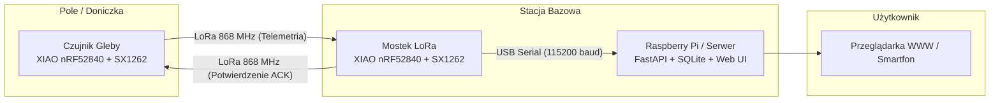
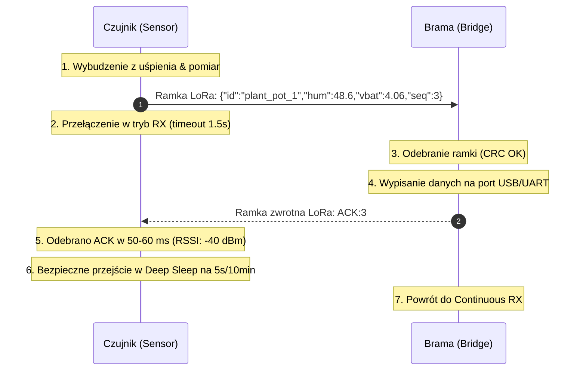

# 📡 System Monitoringu Gleby: LoRa Mesh / Point-to-Point

Kompletny, energooszczędny system telemetryczny do bezprzewodowego monitorowania wilgotności gleby i stanu zasilania. Projekt obejmuje:
1. **Węzły pomiarowe (Sensory)** oraz **Mostek radiowy (Bramę)** oparte o mikrokontroler **Seeed XIAO nRF52840** i moduł radiowy **Semtech SX1262 (Wio-SX1262)**.
2. **Własny, niskopoziomowy sterownik SX1262 w czystym C** (bez użycia ciężkich bibliotek zewnętrznych takich jak RadioLib czy Arduino-LoRa).
3. **Dwukierunkowy protokół radiowy z potwierdzeniem (Stop-and-Wait ARQ / ACK)**, umożliwiający wprowadzanie czujników w tryb głębokiego uśpienia (*Deep Sleep*).
4. **Serwer bazodanowy i panel wizualizacyjny na Raspberry Pi** oparty o **Python (FastAPI)**, bazę **SQLite** oraz responsywny interfejs **HTML/JavaScript (Chart.js)**.

---

## 🏗️ Architektura Systemu



---

## 📦 Format Ramki Radiowej i Protokół Komunikacji

### 1. Parametry Warstwy Fizycznej (PHY LoRa)
Zarówno nadajnik, jak i odbiornik pracują na ściśle zsynchronizowanych parametrach:
* **Częstotliwość nośna ($F_{RF}$):** `868.0 MHz` (zgodnie z planem pasma ISM EU868)
* **Współczynnik rozproszenia (SF):** `SF7` (128 chipów/symbol) – wysoka przepustowość i niski czas emisji w eterze (*airtime*)
* **Szerokość pasma (BW):** `125 kHz`
* **Kodowanie korekcyjne (CR):** `4/5` (1 bit korekcji na 4 bity danych)
* **Długość preambuły:** `8 symboli`
* **Typ nagłówka:** *Explicit Header* (nagłówek w ramce zawiera długość ładunku i włączone CRC)
* **Suma kontrolna (CRC):** Włączona sprzętowo w modemie SX1262
* **Sync Word:** `0x1424` (rejestry `0x0740` i `0x0741` ustawione na prywatną sieć LoRa)
* **Moc nadajnika:** `+14 dBm (25 mW)` – maksymalna dopuszczalna moc ERP w podpaśmie 868.0–868.6 MHz

---

### 2. Ramka Telemetryczna (Czujnik $\rightarrow$ Brama)
Wysyłana cyklicznie przez czujnik po wybudzeniu ze stanu uśpienia.

#### Format ładunku (JSON):
```json
{
  "id": "plant_pot_1",
  "hum": 48.6,
  "vbat": 4.06,
  "seq": 3
}
```

#### Opis pól ramki:
| Pole | Typ | Jednostka | Opis |
| :--- | :--- | :--- | :--- |
| `id` | String | - | Unikalny identyfikator czujnika (np. lokalizacja / roślina) |
| `hum` | Float | `%` | Wilgotność gleby (skalowana 0.0% – 100.0%) |
| `vbat` | Float | `V` | Napięcie ogniwa zasilającego Li-Ion/LiPo (np. 3.00V – 4.20V) |
| `seq` | Integer | - | Numer sekwencyjny pakietu (licznik rosnący, ułatwia wykrywanie strat) |

* **Długość ramki w eterze:** ok. 51 bajtów
* **Czas transmisji (*Airtime*):** ok. **112 ms** (dla SF7, BW125)

---

### 3. Ramka Potwierdzenia ACK (Brama $\rightarrow$ Czujnik)
Odsyłana natychmiast przez bramę po poprawnym odebraniu i zweryfikowaniu sumy kontrolnej CRC.

#### Format ładunku:
```text
ACK:<seq>
```
*Przykład:* `ACK:3`

#### Zasada działania okna ACK:


* **Czas reakcji bramy:** **50–60 ms**
* **Maksymalny czas oczekiwania czujnika (Timeout):** `1500 ms`
* **Gdy brak ACK w oknie czasowym:** czujnik ponawia próbę lub raportuje błąd i zasypia, zapobiegając rozładowaniu baterii.

---

## 🛠️ Warstwa Sprzętowa: Sterownik SX1262 w C

Sterownik został zaimplementowany bezpośrednio na rejestrach i komendach SPI układu Semtech SX1262 (pliki `sx1262.h` i `sx1262.cpp`).

### 1. Definicje wyprowadzeń (Pinout XIAO nRF52840 + Wio-SX1262)
| Funkcja | Pin XIAO | Opis fizyczny |
| :--- | :--- | :--- |
| **NSS (CS)** | `D4` (P0.04) | Sprzętowy Chip Select magistrali SPI |
| **RESET** | `D2` (P0.28) | Sprzętowy reset układu radiowego (aktywny stanem LOW) |
| **BUSY** | `D3` (P0.29) | Sygnał zajętości układu SX1262 (HIGH = układ przetwarza) |
| **DIO1** | `D1` (P0.03) | Linia przerwań (np. sygnał `RxDone` / `TxDone`) |
| **RXEN** | `D5` (P0.05) | **Sterowanie zewnętrznym przełącznikiem antenowym RF Switch** |
| **SCK** | `D8` (P1.13) | Zegar magistrali SPI |
| **MISO** | `D9` (P1.14) | Linia danych SPI (z SX1262 do XIAO) |
| **MOSI** | `D10` (P1.15) | Linia danych SPI (z XIAO do SX1262) |

---

### 2. Kluczowe rozwiązania inżynieryjne w sterowniku:

1. **Obsługa aktywnego oscylatora TCXO:**
   * Moduł Wio-SX1262 posiada wbudowany precyzyjny oscylator TCXO zasilany z wewnętrznego stabilizatora chipu przez pin **`DIO3`**.
   * Sterownik wysyła komendę `SetDIO3AsTcxoCtrl (0x97)` z napięciem `1.7V` oraz opóźnieniem stabilizacji `5 ms`, a następnie przełącza chip w stan `STDBY_XOSC`. Bez tego pętla PLL nie wystartuje, a układ zgłasza błąd `0x05 (Failure to execute)`.

2. **Sterowanie zewnętrznym przełącznikiem antenowym (RF Switch):**
   * Płytka posiada scalony przełącznik RF separujący tory nadawczy i odbiorczy.
   * **Nadawanie (TX):** Wewnętrzny pin `DIO2` układu radiowego steruje torem TX (`SetDio2AsRfSwitchCtrl: 0x9D`), a pin `D5 (RXEN)` zostaje ustawiony w stan niski (`LOW`).
   * **Odbiór (RX):** Pin `D5 (RXEN)` zostaje wysterowany w stan wysoki (`HIGH`), fizycznie dołączając antenę do wejścia odbiornika LNA.

3. **Odczyt danych z FIFO i pomiar jakości sygnału:**
   * Po odebraniu pakietu sterownik weryfikuje rejestr IRQ pod kątem błędu CRC (`SX1262_IRQ_CRC_ERR`).
   * Pobiera offset i długość danych z bufora przez `GetRxBufferStatus (0x13)`, a następnie odczytuje bajty rozkazem `ReadBuffer (0x1E)`.
   * Pobiera parametry łącza przez `GetPacketStatus (0x14)`:
     $$\text{RSSI [dBm]} = -\frac{\text{RssiPkt}}{2}$$
     $$\text{SNR [dB]} = \frac{\text{SnrPkt}}{4}$$

---

## 🖥️ Warstwa Serwera na Raspberry Pi

Katalog `server/` zawiera kompletny system gromadzenia danych i serwisu WWW.

### 1. Składniki serwera:
* **`serial_bridge.py` (Mostek UART $\rightarrow$ SQLite):**
  * Otwiera port `/dev/ttyACM0` (lub `/dev/ttyUSB0`) z prędkością 115200 baud.
  * Odbiera strumień tekstowy z płytki BRAMY, wyciąga JSON wyrażeniem regularnym, waliduje dane i zapisuje je do bazy SQLite za pomocą `add_measurement()`.
* **`database.py` (Zarządzanie bazą SQLite):**
  * Tabela `measurements`: `(id, timestamp, sensor_id, humidity, battery_voltage)`.
  * Włączony tryb **WAL (Write-Ahead Logging)** zapewniający bezpieczny i szybki jednoczesny zapis z mostka i odczyt z serwera WWW.
  * Indeks na kolumnie `timestamp` dla natychmiastowego renderowania wykresów.
* **`app.py` (Serwer API i aplikacji FastAPI):**
  * `GET /api/latest` – zwraca najświeższy odczyt dla wybranego czujnika.
  * `GET /api/history?limit=50` – zwraca serię danych historycznych do wykresu.
  * `GET /` – serwuje responsywny panel kontrolny HTML.
* **`index.html` (Panel WWW):**
  * Wykres liniowy w czasie rzeczywistym oparty o bibliotekę **Chart.js**.
  * Karty ze stanem wilgotności gleby i poziomem naładowania baterii.

---

## 🚀 Instrukcja Wdrożenia i Uruchomienia

### 1. Wgranie programu na płytki (PlatformIO)

Plik `lora_bridge/src/main.cpp` posiada przełącznik wyboru roli w liniach 17–18:

#### Krok A: Programowanie BRAMY (Bridge)
1. W pliku `main.cpp` ustaw:
   ```c
   #define CURRENT_ROLE ROLE_BRIDGE
   // #define CURRENT_ROLE ROLE_SENSOR
   ```
2. Podłącz pierwszą płytkę (np. `/dev/ttyACM0`) i wgraj program:
   ```bash
   cd lora_bridge
   ~/.platformio_venv/bin/pio run -t upload --upload-port /dev/ttyACM0
   ```

#### Krok B: Programowanie CZUJNIKA (Sensor)
1. W pliku `main.cpp` przestaw rolę:
   ```c
   // #define CURRENT_ROLE ROLE_BRIDGE
   #define CURRENT_ROLE ROLE_SENSOR
   ```
2. Podłącz drugą płytkę (np. `/dev/ttyACM1`) i wgraj program:
   ```bash
   ~/.platformio_venv/bin/pio run -t upload --upload-port /dev/ttyACM1
   ```

---

### 2. Uruchomienie Serwera i Mostka na Raspberry Pi

1. Przejdź do katalogu serwera i zainstaluj wymagane zależności:
   ```bash
   cd server
   pip install fastapi uvicorn pyserial
   ```

2. Uruchom mostek szeregowy (nasłuchuje na płytce wpiętej pod USB):
   ```bash
   python3 serial_bridge.py /dev/ttyACM0
   ```

3. W osobnym terminalu uruchom serwer WWW:
   ```bash
   uvicorn app:app --host 0.0.0.0 --port 8000
   ```

4. Otwórz w przeglądarce adres `http://<IP_RASPBERRY_PI>:8000` (lub `http://localhost:8000`), aby zobaczyć wykresy na żywo!